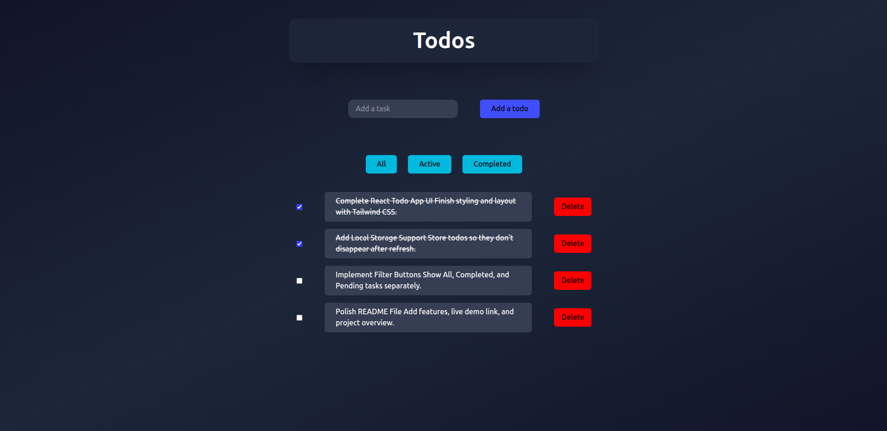

# React Todo App



This project is part of my React learning journey, built as a beginner-level project to understand the fundamentals of React, components, state management, and props.

## Project Overview

The React Todo App is a simple and interactive task manager that allows users to add, update, mark as done, and delete todos.  
It helped me understand React Hooks, component-based architecture, and props drilling.  
Styling was done using Tailwind CSS to maintain a clean, responsive, and modern look.

## Features

- Add new todos with title and description  
- Mark todos as completed  
- Delete unwanted todos  
- Edit todo titles directly  
- Responsive design using Tailwind CSS  
- Built with Vite for fast development and optimized builds

## Live Demo

👉 [View Live Demo](https://dhanajayan-04.github.io/react-todo-app/)

## Usage

To try out the React Todo App locally:

1. Clone this repository:
   ```bash
   git clone https://github.com/Dhanajayan-04/react-todo-app.git
